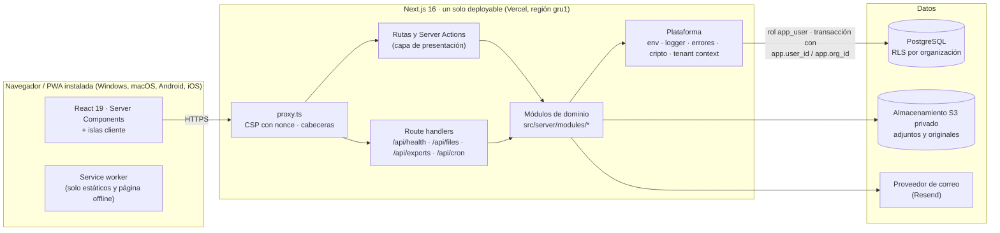

# Arquitectura

KONTARA 27 es un
SaaS multiempresa de gestión financiera. Esta página resume cómo está construido; las razones de cada
decisión están en los [ADR](../adr/).

## Vista general

## Capas

| Capa | Dónde | Puede depender de | Nunca depende de |
|---|---|---|---|
| Presentación | `src/app/**`, `src/components/**` | Módulos (su `index.ts`), `src/lib` | Infraestructura de un módulo, `db` |
| Aplicación | `src/server/modules/<m>/application` | Dominio, puertos (interfaces) | Next.js, Drizzle, HTTP |
| Dominio | `src/server/modules/<m>/domain` | Nada externo | Todo lo demás |
| Infraestructura | `src/server/modules/<m>/infrastructure`, `src/server/platform` | Dominio, puertos, Drizzle, SDKs | Presentación |

- Cada módulo expone **solo** su `index.ts`. Las reglas de ESLint (`no-restricted-imports`) impiden
  importar archivos internos de otro módulo o código de servidor desde un componente cliente.
- Todo `src/server/**` empieza con `import "server-only"`: si un componente cliente lo importa por
  error, el build falla.
- La composición (qué implementación concreta recibe cada servicio) ocurre en
  `src/server/container.ts`. Los servicios reciben interfaces, no clases concretas (inversión de
  dependencias), y las pruebas les pasan dobles en memoria.

## Módulos

| Módulo | Responsabilidad |
|---|---|
| `identity` | Usuarios, contraseñas (Argon2id), sesiones, verificación de correo, recuperación, MFA TOTP y códigos de recuperación |
| `tenancy` | Organizaciones, membresías, invitaciones, roles y permisos configurables, cambio de organización |
| `ledger` | Movimientos, tipos de movimiento, categorías, cuentas y cajas, transferencias, sectores, medios de pago, historial |
| `budgeting` | Presupuestos mensuales/anuales por categoría, sector u organización y sus alertas |
| `reporting` | Dashboard, estado de resultados, flujo de caja, comparaciones y exportaciones (CSV, XLSX, PDF) |
| `importing` | Importación de planillas: lectura, validación, revisión, confirmación y conciliación |
| `documents` | Adjuntos privados con enlaces temporales |
| `scheduling` | Vencimientos, recordatorios y pagos recurrentes |
| `privacy` | Consentimiento de cookies, exportación de datos personales, solicitudes de eliminación |
| `audit` | Registro de auditoría inmutable (solo inserción) |

Preparado para crecer sin reescribir: clientes, proveedores, cuentas por cobrar/pagar, inventario y API
pública se agregan como módulos nuevos con su esquema y sus políticas RLS, sin tocar los existentes.

## Multiempresa (multi-tenant)

1. La organización activa viaja en la URL: `/app/<slug-de-la-organización>/…`. Cambiar de empresa es
   navegar a otro slug; no hay estado oculto en la sesión y se pueden abrir dos empresas en dos pestañas.
2. En cada request el servidor resuelve la sesión, busca la membresía activa del usuario en esa
   organización y arma un `TenantContext { userId, organizationId, role, permissions }`.
3. Todo acceso a datos de una organización corre dentro de `withTenant(ctx, fn)`: una transacción que
   primero ejecuta `set_config('app.user_id', …, true)` y `set_config('app.org_id', …, true)`.
4. La aplicación se conecta con el rol `app_user`, que **no es dueño de las tablas ni tiene
   `BYPASSRLS`**. Las tablas tienen `ENABLE` y `FORCE ROW LEVEL SECURITY`.
5. Las políticas comparan `organization_id` con `app.current_org_id()`, una función `SECURITY DEFINER`
   que devuelve la organización solo si `app.user_id` tiene una membresía activa en ella. Aunque un bug
   de la aplicación pusiera el `org_id` equivocado, la base no devuelve filas de una empresa ajena.
6. Los permisos finos (quién puede crear, editar, exportar…) se validan en la capa de aplicación con
   `authorize(ctx, "movements.create")`; RLS garantiza el aislamiento entre empresas.
7. Las pruebas de integración `tests/integration/tenant-isolation.test.ts` intentan leer, modificar y
   borrar datos de otra organización con IDs válidos y deben fallar.

## Datos y dinero

- Importes en **unidades menores enteras** (`bigint`, centavos) + código ISO 4217. Nunca `float`.
- En TypeScript el dinero es un valor `Money` sobre `bigint`; el formateo usa `Intl.NumberFormat` con la
  moneda y el idioma de la organización.
- Los totales se calculan en SQL (`sum` sobre `bigint`) y se verifican en pruebas contra cálculos en
  memoria.
- IDs `uuid` v7 (ordenables por tiempo) generados en la aplicación.
- Fechas de movimiento como `date` (día contable, sin hora) y marcas de auditoría como `timestamptz`.

## Seguridad (resumen)

Detalle en [`docs/security/`](../security/).

- Sesiones opacas: token aleatorio de 256 bits en cookie `HttpOnly; Secure; SameSite=Lax`; en la base
  solo se guarda su SHA-256. Expiración deslizante, revocación individual y global.
- Contraseñas con Argon2id (m = 19 MiB, t = 2, p = 1, parámetros mínimos de OWASP).
- MFA TOTP (RFC 6238) con secretos cifrados (AES-256-GCM) y códigos de recuperación hasheados.
- Límite de intentos por IP y por cuenta; respuestas idénticas para cuentas existentes e inexistentes.
- CSP con nonce por request, HSTS, `frame-ancestors 'none'`, `nosniff`, `Referrer-Policy`.
- Toda modificación de datos pasa por Server Actions, que Next.js rechaza si el `Origin` no coincide con el
  host (CSRF; hay una prueba E2E con un envío forjado). Las rutas API solo atienden `GET`: descargas
  (con sesión y permiso; dejan registro de auditoría), salud y la tarea diaria (con `CRON_SECRET`).
- Validación de toda entrada con Zod en el borde; consultas parametrizadas (Drizzle), sin SQL
  concatenado.
- Adjuntos con tipo verificado por firma de bytes, claves aleatorias, descarga por enlace temporal.
- Registro de auditoría append-only: el rol de la aplicación no tiene `UPDATE` ni `DELETE` sobre él.

## Despliegue

| Entorno | App | Base de datos | Archivos | Correo |
|---|---|---|---|---|
| Desarrollo | `next dev` local | PostgreSQL embebido (`embedded-postgres`) | Disco local (`storage/`) | Bandeja local (`.data/outbox/`) |
| CI | GitHub Actions | Servicio `postgres:17` | Disco temporal | Bandeja local |
| Preview | Vercel Preview | Rama de Neon por PR | Bucket de staging | Resend (dominio de pruebas) |
| Producción | Vercel (Pro) | Neon (pooler, región São Paulo) | Cloudflare R2 o S3 | Resend |

Migraciones: `drizzle-kit generate` produce SQL versionado en `drizzle/`; las políticas RLS y funciones
viven en migraciones SQL escritas a mano. En producción las migraciones se aplican con el rol dueño
(`app_owner`) desde el pipeline, nunca con el rol de la aplicación.
